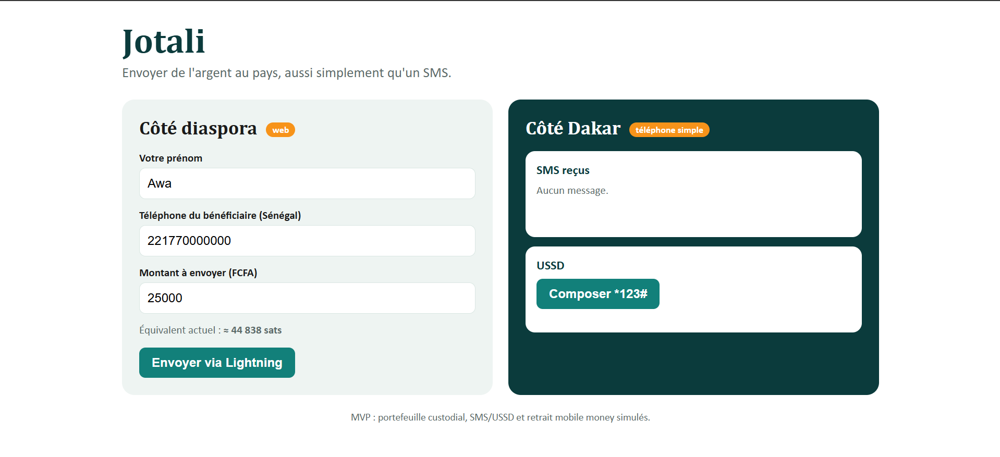
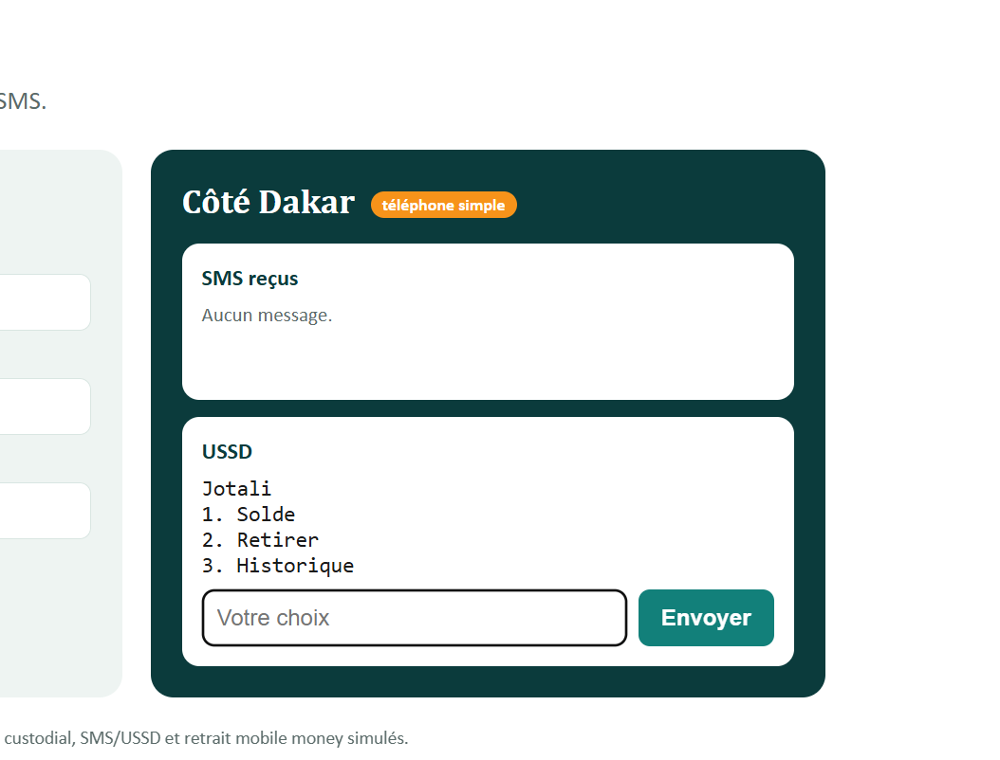
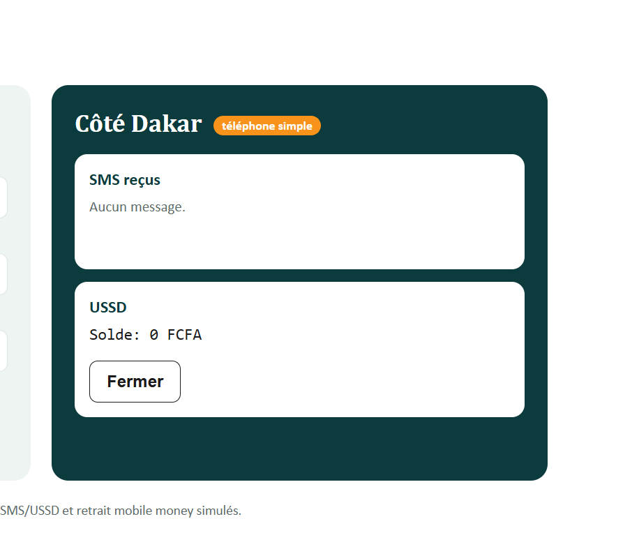
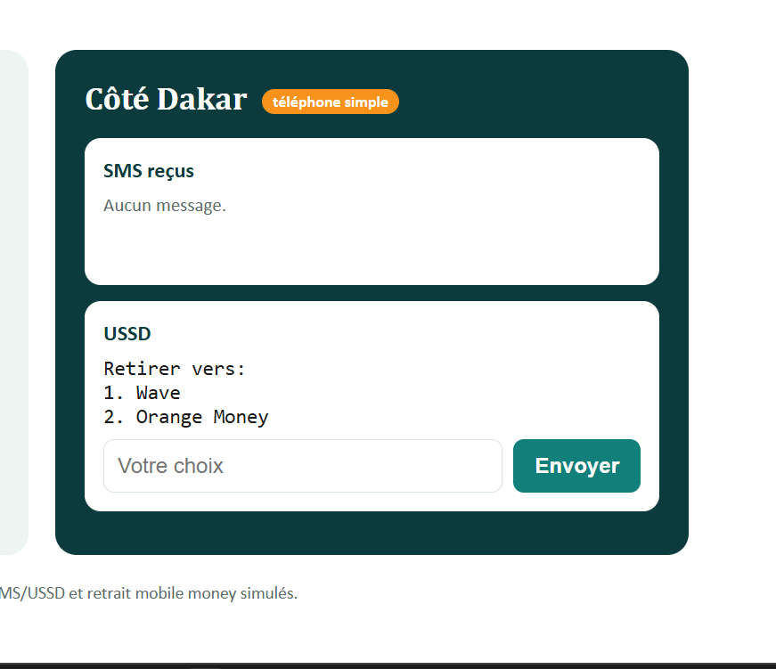

# Jotali

**Envoyer de l'argent au pays, aussi simplement qu'un SMS.**
*Send money home as easily as a text message.*

Projet réalisé en solo pour le **Dakar Bitcoin Days Hackathon #4** (Btrust), thème : *construire des solutions innovantes pour répondre aux problèmes locaux*.

- Vidéo de démo : **[à compléter : lien YouTube]**
- Présentation : [`docs/Jotali_Pitch.pptx`](docs/Jotali_Pitch.pptx)



## Le problème

Le Sénégal dépend fortement des transferts de la diaspora, mais les frais restent élevés, et beaucoup de familles n'ont ni smartphone ni connexion stable.

## La solution

Jotali relie la rapidité et le faible coût de **Bitcoin Lightning** à la réalité du terrain :

1. **Paiement.** L'expéditeur (en France, en Italie, aux États-Unis...) paie une facture Lightning depuis une page web.
2. **Conversion.** Le montant en FCFA est **figé au taux du moment** : le bénéficiaire reçoit exactement ce qui a été promis, sans exposition à la volatilité.
3. **Notification.** Le bénéficiaire reçoit un **SMS**.
4. **Retrait.** Il consulte son solde et retire vers **Wave ou Orange Money** via un menu **USSD**, sans smartphone, sans data, sans connaître Bitcoin.

| Menu USSD | Solde | Retrait |
|---|---|---|
|  |  |  |

## Ce qui est réel et ce qui est simulé (MVP)

| Élément | État dans ce MVP |
|---|---|
| Taux BTC/FCFA (via BTC/EUR et parité fixe 655,957) | Réel (CoinGecko, avec valeur de secours hors-ligne) |
| Création de facture et suivi du paiement | Mode **mock** par défaut ; intégration **Blink** (GraphQL) écrite, à activer avec une clé API |
| Crédit du solde | Réel, **idempotent** (crédité une seule fois) |
| Portefeuille bénéficiaire | **Custodial** (solde en base de données) |
| SMS | **Simulés** (boîte d'envoi en base, affichée dans le simulateur) |
| USSD | Webhook au format Africa's Talking ; testé via un **simulateur de téléphone** |
| Retrait Wave / Orange Money | **Simulé** |

## Architecture

```
Web diaspora (React) --> API Jotali (FastAPI) --> Blink (Lightning)
                              |
                              +--> Base de données (SQLite)
                              +--> SMS / USSD
                              +--> Retrait mobile money (simulé)
```

## Lancer le projet en local

Prérequis : Python 3.11+ et Node.js 18+.

**Backend** (terminal 1)

```bash
cd backend
python -m venv .venv
.venv\Scripts\activate          # Windows
# source .venv/bin/activate     # Mac / Linux
pip install -r requirements.txt
cp .env.example .env            # Windows : copy .env.example .env
python tests_smoke.py           # parcours complet automatisé, doit afficher OK
uvicorn app.main:app --reload
```

Documentation interactive de l'API : http://127.0.0.1:8000/docs

**Frontend** (terminal 2)

```bash
cd frontend
npm install
npm run dev
```

Ouvrir http://localhost:5173.

## Faire la démo

1. Côté diaspora : saisir le montant, cliquer sur **Envoyer via Lightning** (un QR apparaît).
2. Cliquer sur **Simuler le paiement (démo)** : disponible uniquement en mode mock.
3. Côté Dakar : le SMS arrive ; composer `*123#`, puis `1` (solde) ou `2` (retrait).

## API

| Route | Rôle |
|---|---|
| `GET /rate` | Taux BTC/FCFA |
| `POST /transfers` | Crée un transfert et une facture Lightning, taux figé |
| `GET /transfers/{id}` | Statut du transfert (crédite le solde si payé) |
| `POST /dev/transfers/{id}/simulate-paid` | Démo : simule le paiement (mode mock) |
| `GET /phones/{phone}/sms` | Boîte SMS du bénéficiaire |
| `POST /ussd` | Webhook USSD (`CON` / `END`) |

## Passer en réel avec Blink

Dans `backend/.env` : `BLINK_MOCK=false`, `BLINK_API_KEY=...`, `BLINK_BTC_WALLET_ID=...`.
Les requêtes GraphQL (`backend/app/blink.py`) sont à valider avec la documentation Blink, en testant d'abord sur un environnement de test.

## Prochaines étapes

- Partenariat avec un agrégateur mobile money (Wave, Orange Money)
- Conformité réglementaire (BCEAO)
- Passerelle SMS/USSD réelle (opérateur ou agrégateur)
- Pilote avec une communauté de la diaspora
- Tontine numérique : épargne collective avec règles de déblocage

## Construit avec

Python, FastAPI, SQLAlchemy, SQLite, httpx, React, Vite, Bitcoin Lightning, API Blink.

---

### In English

**Jotali** lets the Senegalese diaspora send money home over Bitcoin Lightning. The FCFA amount is locked at payment time, the recipient gets an SMS, checks their balance and withdraws to mobile money through a USSD menu, with no smartphone, no data and no Bitcoin knowledge needed. Built solo for the Dakar Bitcoin Days Hackathon #4.

MVP scope: custodial wallet; SMS, USSD and mobile-money withdrawal are simulated; Lightning invoices run in mock mode by default, with a Blink integration ready to enable via API key. See "Lancer le projet en local" for setup.
